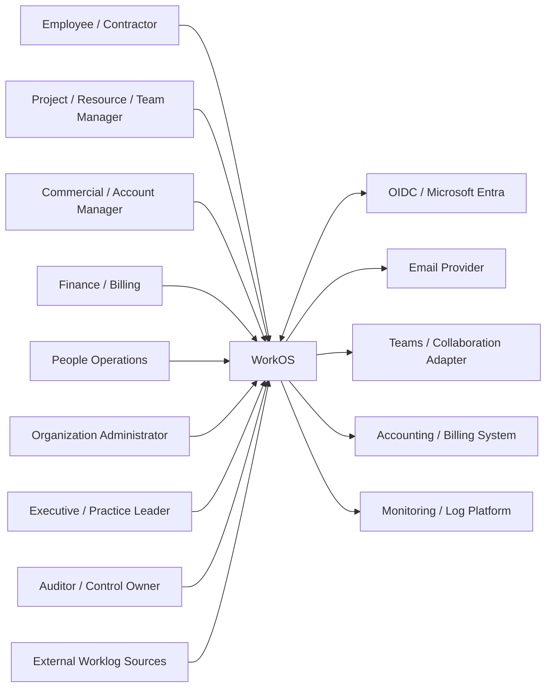
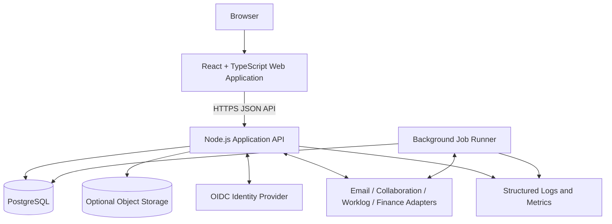
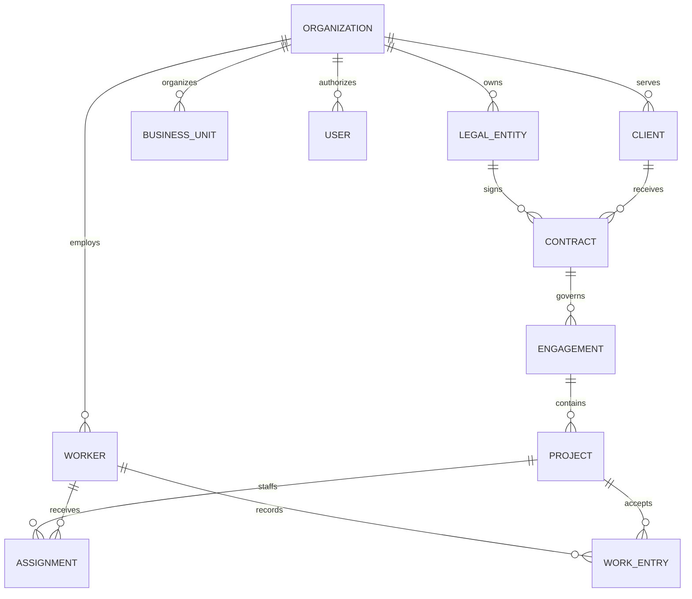
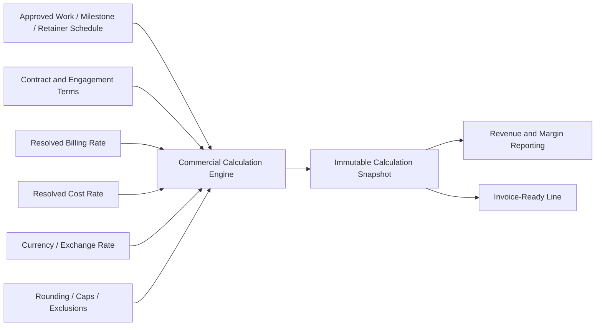
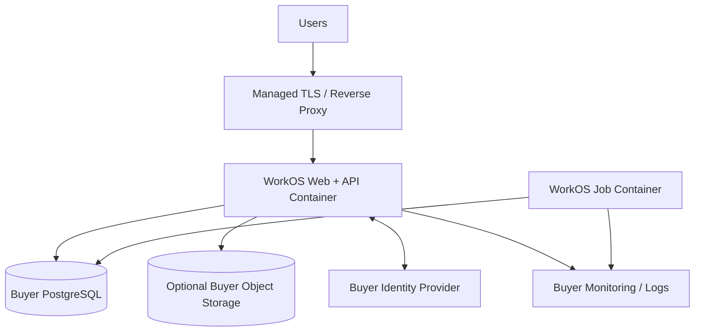

# WorkOS Architecture Overview

**Status:** Target architecture baseline for WorkOS v1  
**Architecture style:** Modular monolith  
**Deployment model:** One isolated application and PostgreSQL database per buyer  
**Reference implementation:** React/TypeScript frontend, Node.js/Express backend and PostgreSQL

## 1. Architecture goals

The WorkOS architecture must:

- Reuse proven behavior from the authorized reference implementation without carrying company-specific branding or assumptions.
- Support multiple organization structures, engagement models and work-capture policies.
- Make permissions, commercial calculations, approvals and audit server authoritative.
- Preserve historical financial and operational truth through effective dating and snapshots.
- Remain deployable by a small buyer technical team without microservice operational complexity.
- Provide clear module boundaries so the current application can be incrementally decomposed from large shared files.
- Support one isolated deployment per buyer while remaining organization-ready in the data model.
- Provide reproducible builds, migrations, tests, monitoring, backup and handover.

## 2. Context



## 3. Container view



### 3.1 Web application

Responsibilities:

- Role-aware navigation and user experience.
- Configuration-driven branding and terminology.
- Forms, workspaces, reports and controlled exports.
- Client-side validation for usability only.
- No authoritative authorization or financial calculation.

### 3.2 Application API

Responsibilities:

- Authentication/session integration.
- Permission and row/data-scope enforcement.
- Domain validation and state transitions.
- Commercial and utilization calculations.
- Approval and period-lock enforcement.
- Audit generation.
- Versioned API contracts.
- Integration orchestration.

### 3.3 Background job runner

Responsibilities:

- Notification delivery and retries.
- Scheduled reminders and approval escalation.
- Period snapshots and controlled recalculation jobs.
- Integration imports/exports.
- Data-quality and leakage-signal refreshes where asynchronous execution is appropriate.

The job runner may initially share the application codebase and deployment artifact while running as a separately invoked process.

### 3.4 PostgreSQL

Responsibilities:

- Authoritative operational and commercial data.
- Referential and consistency constraints.
- Effective-dated terms and immutable snapshots.
- Migration ledger.
- Append-only audit posture.

### 3.5 Optional object storage

Used only for configured supporting files such as contract references, timesheet evidence or generated buyer exports. WorkOS must remain usable without object storage when the buyer disables file features.

## 4. Modular-monolith boundaries

The target codebase must be organized around domain modules rather than UI pages or raw tables.

```text
src/
  modules/
    identity-access/
    organization/
    workforce/
    clients-contracts/
    engagements/
    resource-planning/
    work-capture/
    approvals-policy/
    commercial-finance/
    invoice-readiness/
    reporting-controls/
    integrations/
    audit-governance/
    platform-operations/
```

Each module should contain, as applicable:

```text
<module>/
  domain/
  application/
  api/
  infrastructure/
  ui/
  tests/
```

The existing code may be migrated incrementally. A work package must not move code solely for directory aesthetics; extraction should create a real boundary, test seam or ownership improvement.

## 5. Module responsibilities

### 5.1 Identity and access

- OIDC/local identity adapters.
- Users, roles and active-role sessions.
- Permission registry and role templates.
- User-specific exceptions.
- Organization, legal-entity and row-scope enforcement.
- Session revocation and access review.

### 5.2 Organization

- Organization and legal entities.
- Business units, cost centres, departments, practices, locations and regions.
- Working calendars, reporting periods, currencies and fiscal settings.
- Branding, terminology and feature configuration.
- Guided setup/readiness state.

### 5.3 Workforce

- Worker master and lifecycle.
- Capacity profiles and calendars.
- Manager and operational ownership relationships.
- Skills/capabilities.
- Leave/absence inputs and availability.
- Employee self-service projections.

### 5.4 Clients and contracts

- Client hierarchy and billing entities.
- Contracts/statements of work.
- Purchase orders and commercial limits.
- Version/effective-date management.

### 5.5 Engagements

- Engagement commercial model.
- Projects/workstreams and milestones.
- Internal/pre-sales initiatives.
- Dependency-safe lifecycle controls.

### 5.6 Resource planning

- Demand records.
- Assignments.
- Planned and forecast capacity/utilization.
- Bench, overload, roll-off and staffing risk.
- Assignment-change approval integration.

### 5.7 Work capture

- Daily/weekly work records.
- Work categories, billability and evidence.
- Submission periods and deadlines.
- Correction/reopen history.
- External worklog source mapping.

### 5.8 Approvals and policy

- Generic approval records and stages.
- Routing rules.
- Delegation.
- SLA, reminders and escalation.
- Period locking and controlled reopen.

### 5.9 Commercial and finance

- Billing rate cards and precedence.
- Cost rates and confidentiality.
- Budgets and approved changes.
- Currency and exchange-rate inputs.
- T&M, fixed-fee, milestone, retainer and managed-service calculations.
- Revenue, cost, margin and estimate-at-completion snapshots.

### 5.10 Invoice readiness

- Approved-unbilled sources.
- Invoice-ready batches and lines.
- Adjustments, credits and write-offs.
- No-double-billing controls.
- Billing/accounting export contracts.

### 5.11 Reporting and controls

- Operational and executive dashboards.
- Planned, actual and forecast utilization.
- Commercial and margin reporting.
- Data-quality controls.
- Revenue-leakage signals.
- Reconciliation and controlled export.

### 5.12 Integrations

- Provider configuration and health.
- Identity, email and collaboration adapters.
- Worklog import adapters.
- Finance export adapters.
- Idempotency, retry and event evidence.

### 5.13 Audit and governance

- Append-only audit records.
- Provenance and source/batch metadata.
- Retention and anonymization policy hooks.
- Requirements/release traceability projections.

### 5.14 Platform operations

- Environment validation.
- Health/readiness.
- Migration commands.
- Structured logs and metrics.
- Backup/restore tooling.
- Release metadata.

## 6. Organization-ready data architecture

WorkOS v1 uses one buyer per deployment, but commercial entities must not rely on global singletons that make future legal-entity or organization support impossible.

### 6.1 Ownership hierarchy



### 6.2 Required ownership conventions

- `organization_id` is mandatory on primary domain roots where applicable.
- `legal_entity_id` is mandatory where contracting, currency, tax/billing ownership or reporting requires it.
- Child records derive scope through enforced foreign keys and may include denormalized ownership only when needed for safe query and policy enforcement.
- Application queries must not rely on a client-provided organization ID alone.
- Unique business identifiers such as worker code, client code and project code should be scoped to organization/legal entity according to domain need.

## 7. Effective dating and snapshots

### 7.1 Effective-dated entities

At minimum:

- Worker capacity profiles.
- Assignments.
- Contracts and purchase orders.
- Billing rate cards.
- Cost rates.
- Calendars and exchange-rate inputs.
- Approval and period policies where historical application matters.

Effective-dated records should use explicit start/end dates, non-overlap constraints where appropriate and immutable historical references.

### 7.2 Financial snapshots

Approved period/commercial calculations must persist:

- Source work or milestone reference.
- Quantity and unit.
- Billing-rate source and value.
- Cost-rate source and value.
- Currency and exchange-rate source.
- Rounding rule.
- Revenue, cost and margin outputs.
- Calculation version and timestamp.

Changing a rate card must not rewrite prior snapshots. Controlled recalculation must create a new version and audit evidence.

## 8. API architecture

### 8.1 Versioning

New productized contracts should be introduced under `/api/v1`. Existing routes may remain temporarily behind compatibility adapters during migration.

### 8.2 Contract rules

- Use schema validation for request, query and response boundaries.
- Use stable error codes in addition to user-readable messages.
- Use idempotency keys for applicable imports, integrations and finalization operations.
- Use optimistic concurrency/version fields for high-risk master and commercial records.
- Paginate list endpoints intended for production-scale data.
- Apply authorization and row scope before returning or mutating domain data.
- Do not expose cost/margin fields through broad operational DTOs.

### 8.3 Command/query separation

The product need not implement formal CQRS infrastructure, but API design should distinguish:

- Commands that change state and require policy/audit.
- Queries/read models optimized for workspaces and reports.
- Long-running jobs that return operation/batch status.

## 9. Authorization architecture

Every protected request must satisfy:

```text
authenticated identity
+ active role
+ effective permission
+ organization/legal-entity boundary
+ entity/data-scope rule
+ applicable business policy
```

### 9.1 Enforcement layers

1. **UI navigation and control visibility** for usability.
2. **API permission enforcement** for action authority.
3. **Row/data-scope enforcement** for entity visibility and mutation.
4. **Business-policy enforcement** for state, period, value and delegation rules.
5. **Database constraints/policies** where they materially reduce bypass risk.

UI hiding is never a security boundary.

## 10. Commercial calculation architecture

### 10.1 Calculation service

Commercial calculations must be isolated behind a server-side application service with explicit inputs and versioned outputs.



### 10.2 Precision

- Use decimal/numeric database types for money and rates.
- Do not use binary floating-point values as authoritative currency amounts.
- Centralize currency precision and rounding.
- Include test vectors for boundary, zero, negative adjustment and multi-currency cases.

## 11. Integration architecture

Each provider adapter exposes a stable internal interface and records an integration event.

```text
IdentityProvider
NotificationProvider
CollaborationProvider
WorklogImportProvider
FinanceExportProvider
ObjectStorageProvider
```

Adapters must support:

- Configuration validation without exposing secrets.
- Mock/test provider.
- Timeout and retry policy.
- Idempotency or duplicate prevention.
- Failure event and operational visibility.
- Controlled disabling without corrupting core transactions.

## 12. Deployment architecture

### 12.1 v1 topology



### 12.2 Deployment requirements

- Production Dockerfile.
- Local/demo Docker Compose.
- Explicit migration command/release step.
- Environment schema validation.
- Liveness and readiness checks.
- Structured log output.
- Buyer-owned database and secrets.
- No production demo fallback.
- Version and build metadata visible through a safe endpoint or admin surface.

## 13. Migration strategy from the reference implementation

The commercial bootstrap must follow staged migration:

1. Import approved source files at the pinned commit without Git history.
2. Exclude company-only artifacts and prohibited data.
3. Establish forbidden-term and secret scans.
4. Restore build and existing regression tests in WorkOS.
5. Centralize branding/configuration and neutralize runtime terminology.
6. Introduce organization/legal-entity roots and migrate existing records to the default organization.
7. Extract bounded modules incrementally while maintaining compatibility routes.
8. Add engagement/commercial entities and calculations behind feature/release gates.
9. Add production packaging and acceptance evidence.

A big-bang rewrite is prohibited unless a later approved ADR demonstrates lower overall risk.

## 14. Testing architecture

Testing must include:

- Domain/unit tests for calculations and policy logic.
- API contract tests.
- Authorization matrix and out-of-scope negative tests.
- Migration fresh-install and upgrade tests.
- Integration adapter contract tests.
- Browser journeys by high-risk role.
- Reconciliation tests for commercial reports and invoice-ready totals.
- Production-mode startup/build tests.
- Backup/restore rehearsal.

## 15. Observability

The application and job runner must emit structured events with correlation identifiers for:

- Authentication and session failures.
- Authorization denials.
- Approval and period transitions.
- Import/export operations.
- Integration attempts and failures.
- Commercial calculation/finalization jobs.
- Invoice-ready batch operations.
- Migration and startup readiness.

Logs must not expose passwords, tokens, private keys or unrestricted personal/financial values.

## 16. Initial architecture decisions

The following decisions are adopted for the v1 blueprint and will be formalized as ADRs:

| ADR | Decision |
|---|---|
| ADR-001 | Maintain a clean commercial repository separate from the reference application |
| ADR-002 | Use one isolated buyer deployment and database for v1 |
| ADR-003 | Use a modular monolith rather than microservices |
| ADR-004 | Add organization/legal-entity-ready ownership boundaries |
| ADR-005 | Keep permissions and commercial calculations server authoritative |
| ADR-006 | Use feature flags plus evidence-based release gates |
| ADR-007 | Move toward OIDC and revocable production sessions |
| ADR-008 | Use controlled versioned migrations with fresh/upgrade evidence |

## 17. Architecture acceptance gates

The architecture baseline is accepted when:

- Governing requirements and module boundaries are internally consistent.
- The source-bootstrap work package can map every imported area to a target module.
- The proposed ownership, authorization and effective-date rules can be represented in PostgreSQL.
- The commercial calculation model has deterministic testable inputs/outputs.
- Deployment and migration policies do not depend on hidden manual steps.
- No target decision requires modifying the original repository.
