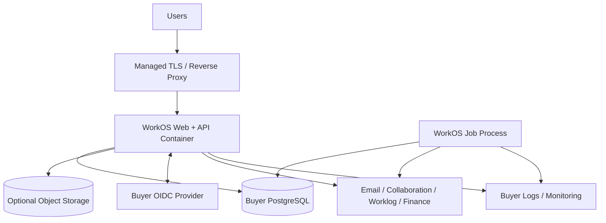

# WorkOS Deployment Architecture

## v1 topology

WorkOS v1 is deployed as one isolated application and PostgreSQL database per buyer.



The API and job process may share one codebase/image while running separate commands.

## Deployment artifacts

- Production multi-stage Dockerfile.
- Local/demo Docker Compose profile.
- Environment schema and safe example values.
- Explicit migration command and migration ledger.
- Health/liveness/readiness endpoints.
- Version/build metadata.
- Backup/restore scripts and runbook.
- Release manifest, migration notes and rollback guidance.

## Configuration classes

1. Non-secret product/organization configuration.
2. Environment settings such as URLs and feature release state.
3. Secrets such as database, OIDC and provider credentials.
4. Buyer data imported through controlled workflows.

Secrets are buyer-owned and never committed. Production startup fails closed on missing/unsafe mandatory configuration.

## Release flow

```text
build and scan
→ migration dry-run/fresh/upgrade tests
→ immutable release artifact
→ backup/readiness gate
→ controlled migration step
→ deploy application/jobs
→ readiness and smoke tests
→ monitored acceptance
```

Automatic application startup is not the only safe migration mechanism.

## Recovery

Recovery objectives are buyer-agreed. Restore rehearsal verifies database version, migrations, organization/configuration, critical control totals, authentication readiness and representative role journeys.

## Environment separation

Demo/UAT and production have separate databases, secrets and deployment profiles. Demo seed, shortcuts and local fallback are not present or enabled in production.

## Portability

The initial package targets standards-based containers and PostgreSQL so it can be deployed to supported cloud/container platforms without embedding one vendor account, ID or secret in source.