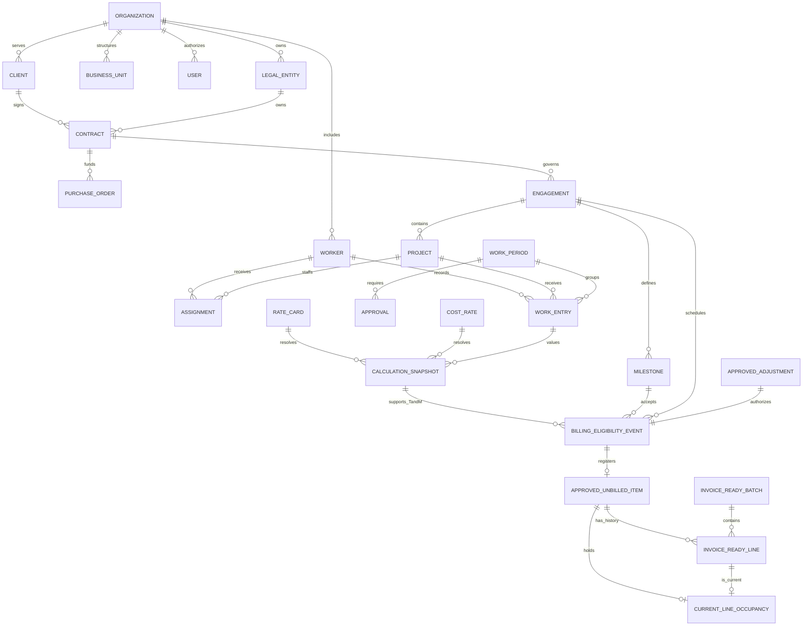

# WorkOS Domain Model

## Scope

The model supports one isolated buyer deployment while retaining explicit organization and legal-entity ownership. Domain behavior is defined by `PRODUCT_REQUIREMENTS.md`; this document defines aggregate boundaries and relationships.

## Core relationship map

## Aggregate roots

- Organization and legal entity.
- User/role/permission configuration.
- Worker and capacity profile.
- Client and contract.
- Engagement and project/workstream.
- Assignment and demand record.
- Work period/work entries.
- Approval policy and approval instance.
- Rate card, cost rate and budget.
- Calculation snapshot.
- Versioned billing-eligibility event and approved-unbilled register.
- Invoice-ready batch and current line-occupancy control.
- Audit and integration operation records.

## Identity and ownership

Primary commercial roots carry `organization_id`. Contracting/reporting entities carry `legal_entity_id` where applicable. Child scope is derived through validated relationships; clients cannot self-select another organization through request data.

Business identifiers are organization/legal-entity scoped according to domain need, for example worker code within organization and contract number within legal entity.

## Effective-dated entities

Capacity profiles, assignments, contracts, POs, rate cards, cost rates, calendars, exchange rates and historically relevant policies use explicit effective dates. Overlap rules are enforced where ambiguity would produce unsafe authorization or calculation.

## Commercial valuation and billing eligibility

A calculation snapshot is valuation evidence; it is not billing authority. A versioned `BILLING_ELIGIBILITY_EVENT` is the only source permitted to enter the approved-unbilled register. The event records its source type and source version, approval or contractual-due evidence, eligible date, currency, amount, organization/legal entity, reversal or supersession relationship, and audit identity.

Supported event sources are:

- An approved eligible T&M calculation snapshot.
- An accepted milestone version.
- A fixed-fee schedule or other approved contractual eligibility event.
- A retainer base-period, rollover, expiry or approved overage event.
- A managed-service accepted-unit or approved fixed-period charge event.
- An approved commercial adjustment.

Each approved-unbilled item references exactly one eligibility-event version. Every invoice-ready line traces through that register item to the same event version.

WorkOS v1 does not split one approved-unbilled-item version across multiple invoice-ready lines. At most one current occupying line/membership may exist for an approved-unbilled-item ID/version, whether a duplicate attempt targets the same batch, another batch or a concurrent request. A database-enforced `CURRENT_LINE_OCCUPANCY` record, uniquely keyed by approved-unbilled-item ID/version, points to the current invoice-ready line and batch; the invariant is not inferred only from parent batch state.

Historical line/membership versions remain immutable. A valid pre-export cancellation releases the current occupancy atomically while preserving the cancelled line and membership history. The item may be re-batched through a new line/membership version only when its eligibility-event version remains current, unreversed, unsuperseded, in scope and otherwise eligible. `Exported` and `Billed/Confirmed` occupancy is permanent. Corrections use explicit reversal or superseding event/item versions and new correction lines/batches rather than rewriting or reusing prior evidence.

An identical same-key retry returns the existing current line/membership result. A different idempotency key, changed payload or concurrent duplicate for the same item version receives a stable conflict. Partial billing or presentation splitting cannot bypass the invariant; separately billable portions must originate upstream as distinct authorized/versioned eligibility events and approved-unbilled items with reconciled control totals.

Operational earned-management snapshots remain separate and never create billing eligibility by themselves.

## Historical truth

Approved work history, approval decisions, calculation snapshots, billing-eligibility events, approved-unbilled records, invoice-ready line/membership history, occupancy changes and finalized batch lines are not rewritten by later master-data changes. Corrections produce new versions, reversals or superseding evidence.

## Lifecycle guardrails

Closing or retiring a worker, client, contract, engagement or project checks dependent assignments, work, approvals, unbilled value, ownership and commercial balances. Destructive deletes are avoided for production records.

## Boundary rules

- Work evidence is separate from approval.
- Approval is separate from commercial valuation.
- Commercial valuation is separate from billing eligibility.
- Billing eligibility is separate from approved-unbilled registration and invoice-ready batching.
- Current invoice-ready occupancy is database-enforced separately from immutable line/membership history.
- Invoice readiness is separate from statutory invoicing/ledger posting.
- Cost-rate confidentiality is separate from ordinary project visibility.
