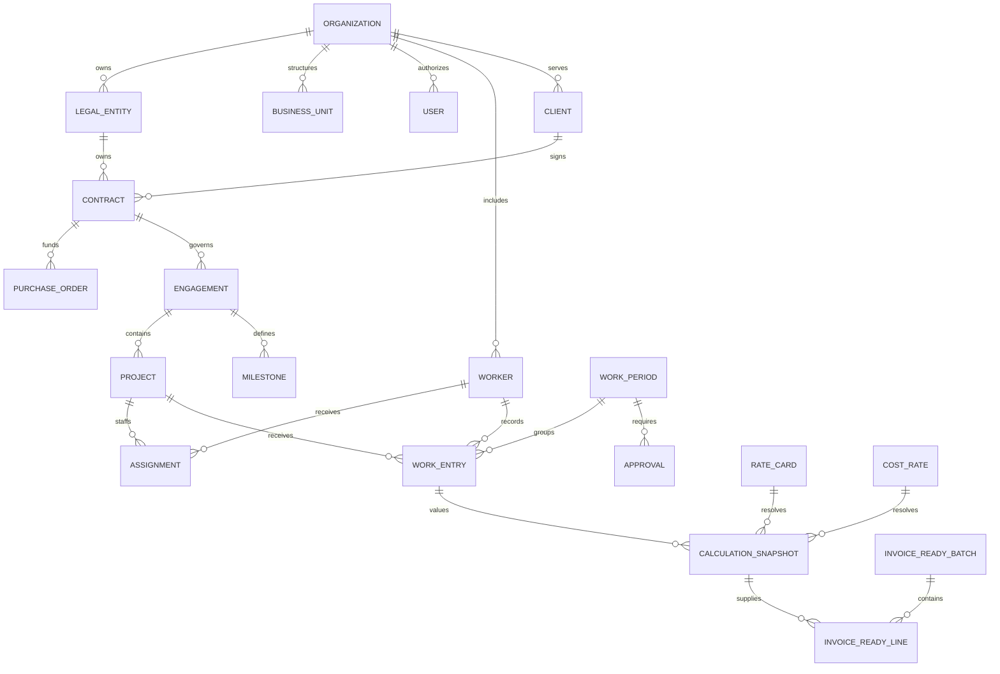

# WorkOS Domain Model

## Scope

The model supports one isolated buyer deployment while retaining explicit organization and legal-entity ownership. Domain behavior is defined by `PRODUCT_REQUIREMENTS.md`; this document defines aggregate boundaries and relationships.

## Core relationship map

## Aggregate roots

- Organization and legal entity.
- User/role/permission configuration.
- Worker and capacity profile.
- Client and contract.
- Engagement and project/workstream.
- Assignment and demand record.
- Work period/work entries.
- Approval policy and approval instance.
- Rate card, cost rate and budget.
- Calculation snapshot.
- Invoice-ready batch.
- Audit and integration operation records.

## Identity and ownership

Primary commercial roots carry `organization_id`. Contracting/reporting entities carry `legal_entity_id` where applicable. Child scope is derived through validated relationships; clients cannot self-select another organization through request data.

Business identifiers are organization/legal-entity scoped according to domain need, for example worker code within organization and contract number within legal entity.

## Effective-dated entities

Capacity profiles, assignments, contracts, POs, rate cards, cost rates, calendars, exchange rates and historically relevant policies use explicit effective dates. Overlap rules are enforced where ambiguity would produce unsafe authorization or calculation.

## Historical truth

Approved work history, approval decisions, calculation snapshots and finalized batch lines are not rewritten by later master-data changes. Corrections produce new versions, reversals or superseding evidence.

## Lifecycle guardrails

Closing or retiring a worker, client, contract, engagement or project checks dependent assignments, work, approvals, unbilled value, ownership and commercial balances. Destructive deletes are avoided for production records.

## Boundary rules

- Work evidence is separate from approval.
- Approval is separate from commercial valuation.
- Commercial valuation is separate from invoice readiness.
- Invoice readiness is separate from statutory invoicing/ledger posting.
- Cost-rate confidentiality is separate from ordinary project visibility.