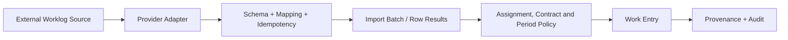
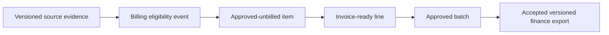

# WorkOS Integration Architecture

## Adapter model

External systems are accessed through provider-neutral internal interfaces:

```text
IdentityProvider
NotificationProvider
CollaborationProvider
WorklogImportProvider
FinanceExportProvider
ObjectStorageProvider
```

Every interface has a deterministic mock/test implementation.

## Core principles

- Core transactions remain valid when optional notification or external delivery fails, unless an approved policy explicitly requires atomic behavior.
- Provider credentials are read from buyer-owned secret storage and never returned by health/configuration APIs.
- Integration operations record provider, operation, entity, idempotency key, status, timestamps and sanitized response evidence.
- Mappings are explicit and reportable; silent name-based matching is avoided for high-risk records.
- External delivery is separated from the authoritative core transaction and cannot silently create duplicate work, notification or finance evidence.

## Inbound worklog flow



Invalid rows remain visible with reason and are not partially hidden as success.

## Billing-eligibility boundary

External or internal raw source records cannot be exported or inserted directly as invoice-ready lines. Source-specific policy must first create a versioned billing-eligibility event, then the corresponding one-to-one approved-unbilled item, before the item can enter an invoice-ready batch.



Source evidence includes an approved eligible T&M snapshot, accepted milestone, approved/due fixed-fee schedule, approved retainer event, approved managed-service event or approved commercial adjustment. The adapter never treats those raw sources or an operational earned-management snapshot as an alternative batchable object.

## Outbound finance flow

An initial finance delivery may originate only from an `Approved` invoice-ready batch. Every exported line retains:

- Invoice-ready batch and line version.
- Approved-unbilled item ID/version.
- Billing-eligibility-event ID/version.
- Source type, ID and immutable source version.
- Organization/legal entity, client, contract and engagement scope.
- Approval or contractual-due/acceptance evidence.
- Eligible date, currency, amount and calculation/policy evidence where applicable.
- Reversal or supersession lineage.
- Batch and export control totals.

The export command revalidates batch state, scope, control totals, idempotency and absence of unresolved reversals/supersessions.

### Provider delivery acceptance

`FinanceExportProvider` receives only lines from an `Approved` batch. Provider acceptance of the exact immutable versioned payload and matching control totals records the accepted export operation and performs the single `Approved → Exported` transition. A timeout, rejection or failed delivery attempt leaves the batch `Approved`, keeps its approved-unbilled items occupied and records the failure for idempotent retry.

A retry with the same idempotency key and payload identity cannot create a second accepted export or duplicate downstream lines. `Exported` and `Billed/Confirmed` batches may support idempotent artifact retrieval or downstream-status confirmation, but they cannot initiate another delivery or transition to `Exported` again.

#### Operating the optional HTTPS finance provider (WOS-INV-006, WOS-INV-007)

Set `FINANCE_EXPORT_ENDPOINT` to the buyer's fixed HTTPS receiver and inject `FINANCE_EXPORT_TOKEN` from its secret store. Grant `commercial.invoice_export.deliver` to authorized finance staff who already hold scoped export access. The receiver must durably deduplicate the `Idempotency-Key` before applying the delivery. Each request includes the operation and batch IDs, schema version, base64 payload, SHA-256, line count, currency and decimal-string total. Return a successful HTTP response with JSON status `accepted` and echo all identity and control fields, omitting the payload.

Reserve an approved batch with `POST /api/v1/invoice-csv/provider-exports` using the existing export command. Keep the returned export ID. Submit `POST /api/v1/invoice-csv/provider-exports/{id}/deliver` with the current owner key. An unconfirmed attempt retains approval and blocks competing CSV export and cancellation. Reuse the reservation to reconcile or retry against the original destination. Provider acceptance retains the export artifact. Billing confirmation remains a subsequent action. Before disabling the integration or changing destinations, reconcile all outstanding reservations against the original receiver.

### CSV artifact acceptance

CSV export does not depend on a future external provider. An `Approved` batch becomes `Exported` only after WorkOS atomically creates and records an immutable, versioned CSV artifact, validates matching control totals and makes that exact artifact available for controlled retrieval.

The accepted CSV operation records:

- Export-operation ID and idempotency key.
- Immutable artifact ID and version.
- Checksum and schema version.
- Line count and batch/export control totals.
- Generated timestamp and authorized actor.
- Batch, line, approved-unbilled and billing-eligibility lineage.

Failed generation leaves the batch `Approved`. Repeated requests with the same idempotency key return the same artifact and operation evidence; they do not regenerate content, create duplicate artifacts or reapply the transition. Corrected content requires versioned reversal/supersession and a new correction batch or export artifact rather than overwriting an accepted artifact.

Export success does not claim downstream statutory invoicing unless a configured confirmation is received.

## Notification and collaboration delivery

WorkOS v1 includes an in-app notification channel plus provider-neutral email and collaboration adapters. A core domain event creates a scoped notification record and one or more authorized delivery attempts; optional external delivery failure does not undo the already valid core transaction.

### Policy classes

Notification policy is resolved server-side from the canonical event matrix in `WOS-INT-002`:

- `ACTION_REQUIRED`: in-app is mandatory for every default recipient; external channels follow buyer policy and recipient preferences unless the buyer requires a channel.
- `CONTROL_MANDATORY`: required recipients and in-app cannot be suppressed by recipient preferences; buyer policy may require external channels.
- `INFORMATIONAL`: recipient preferences may disable, digest or choose channels.
- `OPERATIONAL_CRITICAL`: in-app to configured operational owners plus the configured operational alert route; no recipient opt-out.

### Canonical v1 event matrix

| Event/template key | Trigger boundary | Default relationship recipients | Class |
|---|---|---|---|
| `work_period.submission_due` | Submission reminder threshold | Affected worker | `ACTION_REQUIRED` |
| `work_period.submission_overdue` | Deadline/grace elapsed without accepted submission | Affected worker plus scoped manager or escalation owner | `CONTROL_MANDATORY` |
| `approval.action_required` | A valid generic approval stage becomes pending, including commercial and invoice-batch approvals | Current-stage approver(s) | `ACTION_REQUIRED` |
| `approval.rejected_or_correction_required` | Generic approval rejection/correction decision | Requester; affected worker where applicable; commercial change owner for commercial sources; invoice-batch owner and finance preparer where applicable. Resolve from authoritative scoped relationships and deduplicate identities while retaining all applicable reasons. | `ACTION_REQUIRED` |
| `approval.completed` | Final approval | Requester plus affected worker where distinct | `INFORMATIONAL` |
| `approval.overdue_or_escalated` | Approval due threshold or escalation | Current approver(s) plus escalation target | `CONTROL_MANDATORY` |
| `assignment.created_or_materially_changed` | Assignment becomes effective or approved material change takes effect | Affected worker plus scoped resource/engagement manager where distinct | `ACTION_REQUIRED` |
| `commercial.approval_required` | Proposed commercial change is policy-blocked before submission because the requester/change owner must create, complete or submit the generic approval request; never emitted for a pending generic approval stage | Requester plus commercial change owner where distinct | `ACTION_REQUIRED` |
| `commercial.risk_threshold_breached` | PO, fixed-fee, retainer or margin threshold | Engagement owner plus scoped commercial manager plus finance/billing owner | `CONTROL_MANDATORY` |
| `invoice_batch.action_required` | Batch-owner pre-submission evidence, reconciliation, validation or export-preparation remediation while no generic approval stage is pending; generic approval rejection uses `approval.rejected_or_correction_required` | Batch owner plus finance preparer where distinct | `ACTION_REQUIRED` |
| `invoice_batch.export_failed` | Provider delivery or CSV generation fails | Batch owner plus finance/billing owner plus integration administrator | `OPERATIONAL_CRITICAL` |
| `invoice_batch.exported_or_billed_confirmed` | Accepted export or billing confirmation | Batch owner plus finance/billing owner | `INFORMATIONAL` |
| `integration.delivery_failed_or_degraded` | Provider failed/degraded threshold | Integration administrator plus operations owner | `OPERATIONAL_CRITICAL` |

The canonical event key is also the canonical template key; the selected template version is stored with each notification. Recipient relationships are resolved from authoritative organization, assignment, engagement, approval, commercial, batch and operations records—not from client-supplied addresses or role labels.

### Notification evidence

Every notification stores:

- Event key, source entity/version and triggering operation.
- Organization/legal-entity and row/data-scope context.
- Recipient identity, resolved relationship and recipient reason.
- Template key/version, locale and approved variables.
- Policy class and channel preference/mandatory decision.
- Notification/channel/idempotency identity.
- Attempt number, retry/backoff, provider, accepted/failed status, sanitized response and correlation ID.

A retry cannot create duplicate in-app records or delivery evidence for the same notification/channel/idempotency identity. Users cannot redirect another user's protected notification, remove a mandatory recipient or override a mandatory class. Buyers may add events/recipients or require external channels, but a protected policy change cannot violate the minimum matrix. Client recipients remain out of scope until a client-portal requirement is approved.

For `approval.rejected_or_correction_required`, every applicable protected relationship in the canonical row is mandatory. The server resolves and authorizes the complete bounded, deduplicated set before protected persistence. The event/notification identity, all protected in-app recipient records and all recipient-reason mappings commit atomically through a database transaction with transactional outbox or equivalent. A missing, stale or out-of-scope mandatory relationship, or any protected creation, enqueue or persistence failure, leaves zero successful protected event/in-app recipient mutations; mixed partial state is forbidden. Separate sanitized failure evidence may be recorded but cannot masquerade as protected success. The caller cannot redirect, omit or replace protected recipients. One identity may satisfy multiple relationships but the stored notification evidence must retain every applicable reason or the approved deterministic precedence. Corrected retry under the same decision/idempotency identity creates the complete set exactly once. Optional external email/collaboration delivery is downstream of this commit and retries independently without deleting or duplicating protected state or rolling back the valid core transaction unless separately approved policy requires atomic external delivery, preserving WOS-INT-005 failure isolation.

The generic approval engine emits the shared `approval.*` events for work, leave, assignment, commercial and invoice-batch approvals. A source version/triggering operation may create at most one action-required notification. When a generic approval stage becomes pending, `approval.action_required` is the only action-request event; `commercial.approval_required` and `invoice_batch.action_required` are mutually exclusive pre-stage/domain-remediation events and cannot fire for the same pending-stage transition. A generic rejection/correction decision emits only `approval.rejected_or_correction_required`; the two domain action events cannot fire for that same decision. Domain modules must not create competing approval event keys or duplicate notification records.

Templates and payloads cannot expose secrets, unrestricted personal data, cost rates or margin to unauthorized recipients.

## Identity

OIDC is required for every production deployment, with Microsoft Entra supported through configuration. Identity links and group/role mappings are controlled domain records; the provider does not bypass WorkOS permission and row-scope policy. Missing, invalid or unavailable required production OIDC fails startup/readiness and authentication closed and cannot activate WorkOS local authentication.

## Reliability

Adapters define timeout, retry, backoff and idempotency behavior. Retries cannot duplicate work entries, decisions, notifications, billing-eligibility events, approved-unbilled items, financial lines or outbound batches. Dead-letter/failure states are visible to administrators.

## Health and operations

Provider health reports mode, configuration readiness, mapping gaps, recent success/failure and last checked time without displaying secrets. Finance integration health reports unresolved control-total or confirmation failures without exposing restricted line values. Notification health reports event/template, recipient relationship, policy class, preference decision, queue/retry and delivery failures using sanitized metadata. Buyers assign an operational owner and alert path before production activation.

## Rejection/correction recipient resolution

For `approval.rejected_or_correction_required`, the notification adapter receives a bounded server-resolved recipient set, never a caller-selected address list. Resolution is restricted by source type and organization/legal-entity/data scope and includes the requester, affected worker where applicable, commercial change owner for commercial sources, and invoice-batch owner and finance preparer where applicable. Identity deduplication retains all applicable reasons using deterministic precedence. The complete set is authorized before the canonical event identity, protected in-app records and reason mappings are persisted atomically. A missing, stale or out-of-scope mandatory relationship or any protected persistence/enqueue failure leaves zero successful protected mutation. The decision/event identity makes corrected retry create the complete set exactly once. Optional external channels run only after the protected commit and are independently retriable. The generic event cannot coexist for the same decision with `commercial.approval_required` or `invoice_batch.action_required`.
