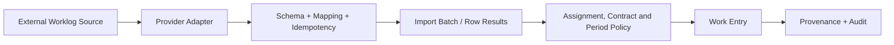

# WorkOS Integration Architecture

## Adapter model

External systems are accessed through provider-neutral internal interfaces:

```text
IdentityProvider
NotificationProvider
CollaborationProvider
WorklogImportProvider
FinanceExportProvider
ObjectStorageProvider
```

Every interface has a deterministic mock/test implementation.

## Core principles

- Core transactions remain valid when optional notification or external delivery fails, unless an approved policy explicitly requires atomic behavior.
- Provider credentials are read from buyer-owned secret storage and never returned by health/configuration APIs.
- Integration operations record provider, operation, entity, idempotency key, status, timestamps and sanitized response evidence.
- Mappings are explicit and reportable; silent name-based matching is avoided for high-risk records.

## Inbound worklog flow



Invalid rows remain visible with reason and are not partially hidden as success.

## Outbound finance flow

Invoice-ready batches produce versioned export payloads with line traceability, currency, totals, adjustments and control totals. Export success does not automatically claim downstream statutory invoicing unless a configured confirmation is received.

## Identity

OIDC is the primary production target, with Microsoft Entra supported through configuration. Identity links and group/role mappings are controlled domain records; the provider does not bypass WorkOS permission and row-scope policy.

## Reliability

Adapters define timeout, retry, backoff and idempotency behavior. Retries cannot duplicate work entries, decisions, financial lines or outbound batches. Dead-letter/failure states are visible to administrators.

## Health and operations

Provider health reports mode, configuration readiness, mapping gaps, recent success/failure and last checked time without displaying secrets. Buyers assign an operational owner and alert path before production activation.