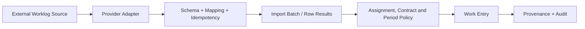

# WorkOS Integration Architecture

## Adapter model

External systems are accessed through provider-neutral internal interfaces:

```text
IdentityProvider
NotificationProvider
CollaborationProvider
WorklogImportProvider
FinanceExportProvider
ObjectStorageProvider
```

Every interface has a deterministic mock/test implementation.

## Core principles

- Core transactions remain valid when optional notification or external delivery fails, unless an approved policy explicitly requires atomic behavior.
- Provider credentials are read from buyer-owned secret storage and never returned by health/configuration APIs.
- Integration operations record provider, operation, entity, idempotency key, status, timestamps and sanitized response evidence.
- Mappings are explicit and reportable; silent name-based matching is avoided for high-risk records.

## Inbound worklog flow



Invalid rows remain visible with reason and are not partially hidden as success.

## Billing-eligibility boundary

External or internal raw source records cannot be exported or inserted directly as invoice-ready lines. Source-specific policy must first create a versioned billing-eligibility event, then the corresponding one-to-one approved-unbilled item, before the item can enter an invoice-ready batch.


Source evidence includes an approved eligible T&M snapshot, accepted milestone, approved/due fixed-fee schedule, approved retainer event, approved managed-service event or approved commercial adjustment. The adapter never treats those raw sources or an operational earned-management snapshot as an alternative batchable object.

## Outbound finance flow

`FinanceExportProvider` receives only approved or finalized invoice-ready batch lines. Every exported line retains:

- Invoice-ready batch and line version.
- Approved-unbilled item ID/version.
- Billing-eligibility-event ID/version.
- Source type, ID and immutable source version.
- Organization/legal entity, client, contract and engagement scope.
- Approval or contractual-due/acceptance evidence.
- Eligible date, currency, amount and calculation/policy evidence where applicable.
- Reversal or supersession lineage.
- Batch and export control totals.

The export command revalidates batch state, scope, control totals, idempotency and absence of unresolved reversals/supersessions. A provider retry cannot create a second active/final export or duplicate downstream line. Export success does not automatically claim downstream statutory invoicing unless a configured confirmation is received.

## Identity

OIDC is the primary production target, with Microsoft Entra supported through configuration. Identity links and group/role mappings are controlled domain records; the provider does not bypass WorkOS permission and row-scope policy.

## Reliability

Adapters define timeout, retry, backoff and idempotency behavior. Retries cannot duplicate work entries, decisions, billing-eligibility events, approved-unbilled items, financial lines or outbound batches. Dead-letter/failure states are visible to administrators.

## Health and operations

Provider health reports mode, configuration readiness, mapping gaps, recent success/failure and last checked time without displaying secrets. Finance integration health also reports unresolved control-total or confirmation failures without exposing restricted line values. Buyers assign an operational owner and alert path before production activation.