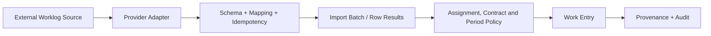

# WorkOS Integration Architecture

## Adapter model

External systems are accessed through provider-neutral internal interfaces:

```text
IdentityProvider
NotificationProvider
CollaborationProvider
WorklogImportProvider
FinanceExportProvider
ObjectStorageProvider
```

Every interface has a deterministic mock/test implementation.

## Core principles

- Core transactions remain valid when optional notification or external delivery fails, unless an approved policy explicitly requires atomic behavior.
- Provider credentials are read from buyer-owned secret storage and never returned by health/configuration APIs.
- Integration operations record provider, operation, entity, idempotency key, status, timestamps and sanitized response evidence.
- Mappings are explicit and reportable; silent name-based matching is avoided for high-risk records.
- External delivery is separated from the authoritative core transaction and cannot silently create duplicate work, notification or finance evidence.

## Inbound worklog flow



Invalid rows remain visible with reason and are not partially hidden as success.

## Billing-eligibility boundary

External or internal raw source records cannot be exported or inserted directly as invoice-ready lines. Source-specific policy must first create a versioned billing-eligibility event, then the corresponding one-to-one approved-unbilled item, before the item can enter an invoice-ready batch.


Source evidence includes an approved eligible T&M snapshot, accepted milestone, approved/due fixed-fee schedule, approved retainer event, approved managed-service event or approved commercial adjustment. The adapter never treats those raw sources or an operational earned-management snapshot as an alternative batchable object.

## Outbound finance flow

An initial finance delivery may originate only from an `Approved` invoice-ready batch. Every exported line retains:

- Invoice-ready batch and line version.
- Approved-unbilled item ID/version.
- Billing-eligibility-event ID/version.
- Source type, ID and immutable source version.
- Organization/legal entity, client, contract and engagement scope.
- Approval or contractual-due/acceptance evidence.
- Eligible date, currency, amount and calculation/policy evidence where applicable.
- Reversal or supersession lineage.
- Batch and export control totals.

The export command revalidates batch state, scope, control totals, idempotency and absence of unresolved reversals/supersessions.

### Provider delivery acceptance

`FinanceExportProvider` receives only lines from an `Approved` batch. Provider acceptance of the exact immutable versioned payload and matching control totals records the accepted export operation and performs the single `Approved → Exported` transition. A timeout, rejection or failed delivery attempt leaves the batch `Approved`, keeps its approved-unbilled items occupied and records the failure for idempotent retry.

A retry with the same idempotency key and payload identity cannot create a second accepted export or duplicate downstream lines. `Exported` and `Billed/Confirmed` batches may support idempotent artifact retrieval or downstream-status confirmation, but they cannot initiate another delivery or transition to `Exported` again.

### CSV artifact acceptance

CSV export does not depend on a future external provider. An `Approved` batch becomes `Exported` only after WorkOS atomically creates and records an immutable, versioned CSV artifact, validates matching control totals and makes that exact artifact available for controlled retrieval.

The accepted CSV operation records:

- Export-operation ID and idempotency key.
- Immutable artifact ID and version.
- Checksum and schema version.
- Line count and batch/export control totals.
- Generated timestamp and authorized actor.
- Batch, line, approved-unbilled and billing-eligibility lineage.

Failed generation leaves the batch `Approved`. Repeated requests with the same idempotency key return the same artifact and operation evidence; they do not regenerate content, create duplicate artifacts or reapply the transition. Corrected content requires versioned reversal/supersession and a new correction batch or export artifact rather than overwriting an accepted artifact.

Export success does not claim downstream statutory invoicing unless a configured confirmation is received.

## Notification and collaboration delivery

WorkOS v1 includes an in-app notification channel plus provider-neutral email and collaboration adapters. A core domain event creates a scoped notification record and one or more authorized delivery attempts; optional external delivery failure does not undo the already valid core transaction.

Notification configuration covers:

- Versioned templates and locale-aware rendering.
- Recipient resolution from active identity, role, relationship and organization/legal-entity scope.
- User/channel preferences subject to mandatory-control notification policy.
- In-app, email and collaboration channel eligibility.
- Idempotency keys, retries, backoff and final delivery evidence.
- Sanitized provider response, correlation and operational health.
- Sensitive-data minimization and channel-specific payload policy.

A retry cannot create duplicate in-app records or delivery evidence for the same notification/channel/idempotency identity. Users cannot redirect another user's protected notification or override mandatory recipients. Templates and payloads cannot expose secrets, unrestricted personal data, cost rates or margin to unauthorized recipients.

## Identity

OIDC is the production identity target, with Microsoft Entra supported through configuration. Identity links and group/role mappings are controlled domain records; the provider does not bypass WorkOS permission and row-scope policy. Production identity failure is fail-closed and cannot activate WorkOS local authentication.

## Reliability

Adapters define timeout, retry, backoff and idempotency behavior. Retries cannot duplicate work entries, decisions, notifications, billing-eligibility events, approved-unbilled items, financial lines or outbound batches. Dead-letter/failure states are visible to administrators.

## Health and operations

Provider health reports mode, configuration readiness, mapping gaps, recent success/failure and last checked time without displaying secrets. Finance integration health reports unresolved control-total or confirmation failures without exposing restricted line values. Notification health reports template, preference, queue/retry and delivery failures using sanitized metadata. Buyers assign an operational owner and alert path before production activation.
