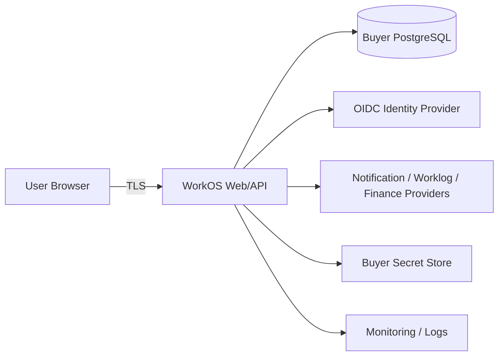

# WorkOS Security Architecture

## Trust boundaries

The browser and all external providers are untrusted inputs. The API and database enforce authoritative policy.

## Authorization model

Every protected action combines identity, active role, permission, organization/legal entity, row/data relationship and current business policy. Delegation grants only the delegator's valid authority for the permitted entity/time range.

## Identity and sessions

- Every production deployment requires named accounts and configured OIDC. Missing, invalid or unavailable required OIDC configuration fails startup/readiness and authentication closed.
- WorkOS local authentication and shared/demo identities are limited to approved non-production/demo profiles, are disabled or absent in production and cannot be activated as a production fallback.
- Sessions are time limited, securely cookie/token managed and revocable in the target state.
- Disabled/leaver identities lose new access immediately and active sessions are revoked according to policy.
- Authentication and role-switch events are audited.

## Application protections

- Server-side schema validation and safe error contracts.
- Explicit CORS, CSRF and security-header posture.
- Persistent/distributed login throttling strategy for production.
- Parameterized database access and least-privilege database identities.
- Sensitive DTO/log filtering for personal, cost and margin data.
- Secure defaults and fail-closed production configuration.

## Data protection

Encryption in transit is mandatory. Managed database/storage encryption at rest is expected from the buyer platform. Secrets remain outside source and normal database configuration. Retention, anonymization and exports are governed and audited.

## Audit and monitoring

Security-relevant events include login failures, session/role changes, permission changes, denials, exports, commercial changes, integration failures and administrative configuration changes. Logs use correlation IDs and avoid secret/full-payload exposure.

Ordinary organization/legal-entity audit reads remain restricted to the exact server-resolved pair. Null-scope deployment records use a separate read-only view that requires an active account, an active role still assigned to that account, and an explicit per-user `audit.deployment.view` grant. Organization-owned rows have a separate view requiring an active account, an active assigned role, and an explicit per-organization `audit.organization.view` designation. Both permissions are protected, denied to every role by default, and cannot be enabled role-wide. Organization grants are managed only by an active permission manager with a verified scope in the same organization; self-grants are rejected. The deployment query selects only rows with both scope columns null; the organization query selects only the requested organization with a null legal-entity scope and revalidates the designation in its final data query. Both views apply shared audit-history redaction, and neither exposes rows from other scopes. No auditor grant is provisioned by the application or migration.

## Verification

Each protected module includes positive and negative authorization tests, cross-organization scope tests, direct API tests and browser journeys. Production-mode tests prove that missing, invalid or unavailable required OIDC configuration fails closed and never enables local authentication. Security review and vulnerability disposition are release gates; buyer-specific penetration testing remains part of deployment acceptance.

## Bounded process-local authentication protection

The current implementation uses fixed monotonic 15-minute windows, at most 10,000 live hashed entries, per-IP aggregate protection and per-input local-login or fixed callback buckets. Expired entries are reclaimed; capacity exhaustion fails closed without evicting active protections. Local login is rejected before limiter/database work when disabled or in production. Rate configuration must be a positive integer within the documented range.

Express trusts forwarded addresses only through explicitly configured IP/CIDR peers; default direct socket identity ignores forwarded headers. The same resolved address supplies throttle and audit context. Buyer ingress must sanitize forwarding headers and restrict direct access. Process restarts reset counters and replicas do not share them: the persistent/distributed production strategy above remains required and is not accepted by this incremental fix.
