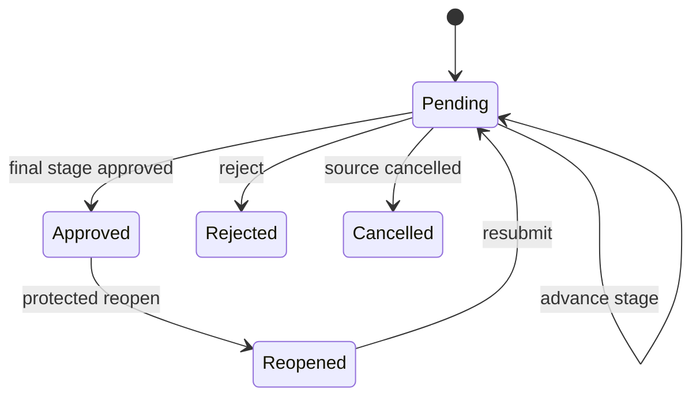

# Approval and Policy Engine Specification

**Governing requirements:** WOS-CORE-003, WOS-CORE-005; WOS-ORG-009; WOS-IAM-003, WOS-IAM-005, WOS-IAM-010; WOS-APR-001 through WOS-APR-008.

## Outcome

A reusable engine routes work, leave, assignment, budget, commercial and invoice-ready decisions through scoped, auditable and configurable stages.

## Policy model

A policy defines entity type, organization/legal entity, optional engagement/project/worker criteria, value threshold, stage sequence, approver role/relationship, SLA, reminder/escalation and effective dates.

An approval instance records source entity/version, requester, current stage, status, due date and immutable decision history.

## States

Only the current pending stage can be decided. Bulk operations independently validate every item and fail safely with per-item outcomes.

## Delegation

Delegations are time-bound, role/entity scoped and cannot exceed the delegator's current permission or data scope. Revocation and leaver changes invalidate future use.

## Period policy

Periods progress through Open, Submission Closed, Approval Closed and Financially Locked. Protected reopen requires reason, authority and audit; it does not erase prior decisions/snapshots.

## Authorization and audit

Decision authority combines active role, permission, organization/legal entity, source-entity relationship, policy stage and delegation. Decision, reassignment, escalation, delegation and reopen actions are audited.

## Acceptance cases

Positive:

- Single- and multi-stage approvals for timesheet, assignment and commercial change.
- Valid delegation decides only covered scoped items during its effective window.
- SLA reminders/escalation are idempotent and reportable.

Negative:

- Stale/non-current stage, out-of-scope record, expired delegation, self-approval prohibition and financially locked change are denied.
- Bulk selection cannot use one authorized record to authorize others.
- Changing a policy does not rewrite prior approval history.

## Migration and rollback

Existing approval records map to generic instances with preserved entity links and decisions. Compatibility endpoints remain until parity tests pass. Rollback preserves migrated records and disables new policy routes rather than deleting evidence.