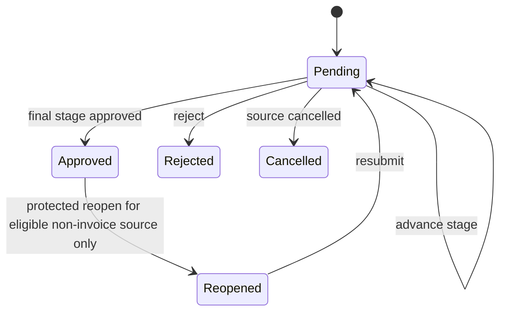

# Approval and Policy Engine Specification

**Governing requirements:** WOS-CORE-003, WOS-CORE-005; WOS-ORG-009; WOS-IAM-003, WOS-IAM-005, WOS-IAM-010; WOS-APR-001 through WOS-APR-008; WOS-INT-002.

## Outcome

A reusable engine routes work, leave, assignment, budget, commercial and invoice-ready decisions through scoped, auditable and configurable stages and emits one canonical notification-event family for approval work across all domains.

## Policy model

A policy defines entity type, organization/legal entity, optional engagement/project/worker criteria, value threshold, stage sequence, approver role/relationship, SLA, reminder/escalation and effective dates.

An approval instance records source entity/version, requester, current stage, status, due date and immutable decision history.

## States

Only the current pending stage can be decided. Bulk operations independently validate every item and fail safely with per-item outcomes.

Generic `Approved → Reopened` is available only when the governing source-type state machine defines a valid atomic transition back to a correctable state. **Invoice-ready batches are excluded:** once an invoice batch reaches `Approved`, its approval instance is final for that batch version and cannot be generically reopened. A stale, concurrent or replayed reopen attempt for an `Approved`, `Exported`, `Billed/Confirmed` or `Cancelled` invoice batch returns a stable conflict without changing approval, batch, occupancy or export state.

## Delegation

Delegations are time-bound, role/entity scoped and cannot exceed the delegator's current permission or data scope. Revocation and leaver changes invalidate future use. Under WOS-APR-004 a new grant applies only to approval instances created after the grant. A pending instance stays outside that grant across stage changes. Changing the delegate, role, effective dates or active status starts a new grant boundary. Editing the reason preserves the boundary.

## Period policy

Periods progress through Open, Submission Closed, Approval Closed and Financially Locked. Protected reopen requires reason, authority and audit; it does not erase prior decisions or snapshots and remains subject to the source-type state machine.

## Canonical approval notification events

The approval engine, not individual domain modules, emits the shared versioned `approval.*` events defined by WOS-INT-002 for work, leave, assignment, commercial and invoice-batch approvals:

| Event/template key | Trigger | Default relationship recipients | Policy class |
|---|---|---|---|
| `approval.action_required` | A valid generic approval stage becomes pending | Current-stage approver or approvers | `ACTION_REQUIRED` |
| `approval.rejected_or_correction_required` | Rejection or correction-required decision | Requester; affected worker where applicable; commercial change owner for commercial sources; invoice-batch owner and finance preparer where applicable. Resolve from authoritative scoped relationships, deduplicate identities and retain all applicable recipient reasons or deterministic precedence. | `ACTION_REQUIRED` |
| `approval.completed` | Final approval | Requester plus affected worker where distinct | `INFORMATIONAL` |
| `approval.overdue_or_escalated` | Due threshold exceeded or escalation created | Current approver or approvers plus configured escalation target | `CONTROL_MANDATORY` |

Event identity is deterministic from approval-instance ID/version, stage or decision version, event key and triggering operation ID. Replaying the same transition or retrying delivery must not create a second domain event, in-app record or accepted channel-delivery result.

### Mutually exclusive domain-action events

Domain modules may emit their own canonical action event only outside a pending generic approval stage:

- `commercial.approval_required` is a **pre-submission requester/change-owner event**. It may be emitted only when a proposed rate, budget, PO, contract-term or commercial-policy mutation is policy-blocked because the requester/change owner must create, complete or submit the generic approval request. It is never emitted for approvers and never emitted when a valid generic approval stage is pending.
- `invoice_batch.action_required` is a **batch-owner remediation event**. It may be emitted only for pre-submission evidence, reconciliation, validation or export-preparation deficiencies while no generic approval stage is pending. A generic approval rejection or correction-required decision uses `approval.rejected_or_correction_required`, not `invoice_batch.action_required`.

For one source entity/version and triggering operation, at most one action-required notification event may be created. If a generic approval stage becomes pending, `approval.action_required` is the exclusive action-request event and suppresses the two domain-action events for that transition. If a generic rejection/correction decision is recorded, `approval.rejected_or_correction_required` is the exclusive action-required event for that decision and suppresses both domain-action events.

Domain modules may provide approved template variables and source links, but must not create competing event keys such as separate timesheet-, leave-, assignment-, commercial- or batch-specific versions of the same approval transition. Domain-specific non-approval events remain separate, for example `assignment.created_or_materially_changed`, `commercial.risk_threshold_breached` and `invoice_batch.export_failed`.

Recipient resolution is server-authoritative. The engine resolves current approvers, requester, affected worker, commercial change owner, invoice-batch owner, finance preparer and escalation target from the approval instance, source type, governing source contract, policy, delegation and organization/legal-entity/entity relationship at the triggering version. Client-supplied recipients, role labels or addresses are never authoritative. A missing, stale or out-of-scope mandatory source-owner relationship fails closed visibly; callers cannot redirect or omit protected recipients. Identity deduplication preserves all applicable recipient reasons or the approved deterministic precedence.

Assignment changes, creation requests and leave approvals may specify a positive whole-minute reminder lead shorter than the stage duration. During that window, each eligible named approver or bound delegate receives one in-app reminder referring to the original action. The deadline closes the delivery window. Reading a reminder acknowledges only that receipt. To discontinue reminders for future requests, adopt a prospective policy without a lead. Retain migration 138 and use a compatible worker for instances already governed by a timed policy.

A named work-stage approver and an eligible delegate each receive a reminder or overdue notice when the policy calls for one. If the delegate is also the escalation target, one overdue receipt retains both reasons. Revoking a grant ends future delegated decisions and deliveries. Existing decision and delivery evidence remains available within the recipient's current scope.

Assignment and leave policies may specify whole minutes per stage. The first stage starts when its approval instance is created. Subsequent stages start at the recorded decision that opened them. The inspector reports the deadline and overdue status at the server observation time for current pending stages. Closed, superseded and untimed instances have no current deadline.

## Authorization and audit

Decision authority combines active role, permission, organization/legal entity, source-entity relationship, policy stage and delegation. Decision, reassignment, escalation, delegation and reopen actions are audited.

Each emitted approval notification retains the approval-instance/source version, stage or decision version, triggering operation ID, recipient relationship/reason, policy class, template version, organization/legal-entity scope and notification idempotency identity.

## Acceptance cases

Positive:

- Single- and multi-stage approvals for work, leave, assignment, commercial and invoice-batch changes.
- Valid delegation decides only covered scoped items during its effective window.
- One `approval.action_required` event is emitted when a stage becomes pending and is delivered to the current-stage approvers.
- A policy-blocked commercial draft emits `commercial.approval_required` to the requester/change owner before submission, then emits only `approval.action_required` after the generic stage becomes pending.
- A batch evidence/reconciliation deficiency emits `invoice_batch.action_required` to the batch owner before submission, then emits only `approval.action_required` after the generic stage becomes pending.
- Generic rejection/correction reaches the requester plus every applicable affected-worker/commercial-owner/invoice-batch-owner/finance-preparer relationship after identity deduplication, preserving recipient reasons.
- Completion and escalation emit the canonical shared event key once with the required relationship recipients and policy class.
- SLA reminders/escalations are idempotent and reportable.
- Invoice-batch correction/rejection remains possible while the batch is `Draft` or `Under Review`; final approval atomically leaves no pending stage and moves the batch to `Approved`.

Negative:

- Stale/non-current stage, out-of-scope record, expired delegation, self-approval prohibition and financially locked change are denied.
- Bulk selection cannot use one authorized record to authorize others.
- Changing a policy does not rewrite prior approval history.
- Retrying the same transition cannot emit duplicate approval events or accepted deliveries.
- A pending commercial or invoice-batch approval cannot also emit its domain-specific action-required event for the same operation.
- An approval rejection/correction cannot also emit `commercial.approval_required` or `invoice_batch.action_required` for the same decision.
- A domain module cannot replace a canonical `approval.*` key with an incompatible domain-specific key.
- A caller cannot redirect a notification, suppress a mandatory recipient or broaden recipient scope.
- Missing, stale, out-of-scope or partially enqueued mandatory source-owner recipients fail closed visibly.
- Generic reopen of an invoice batch in `Approved`, `Exported`, `Billed/Confirmed` or `Cancelled` is rejected without mutating batch, approval, occupancy or export state.

## Migration and rollback

Existing approval records map to generic instances with preserved entity links and decisions. Compatibility endpoints remain until parity tests pass. Rollback preserves migrated records and disables new policy routes rather than deleting evidence. Notification-event migration preserves event/idempotency identities so replay cannot create duplicate records.

## WOS-00F invoice-batch specialization

- Correction/rejection is allowed while an invoice batch is `Draft` or `Under Review`. Final approval atomically records the terminal decision and enters `Approved`, leaving no pending instance.
- Invoice-batch generic reopen is forbidden for `Approved`, `Exported`, `Billed/Confirmed` and terminal `Cancelled`. A stale, concurrent or replayed reopen returns the same stable conflict with no approval, batch, membership, occupancy or export mutation.
- Before successful export, an authorized material correction performs protected `Approved → Cancelled`, reason and audit recording, and occupancy release in one transaction. A replacement version selects still-current eligible items and has a new approval; prior approval and membership history are immutable.
- Failed export leaves `Approved` and does not reopen approval. After export, authorized versioned reversal/supersession creates eligibility for a new correction batch and approval; exported/billed versions are not reopened or cancelled.

For `approval.rejected_or_correction_required`, the server resolves a finite recipient set from the source type and authoritative scoped relationships. Requester is mandatory; affected worker is included where applicable; commercial-source decisions include the commercial change owner; invoice-batch decisions include the batch owner and finance preparer where applicable. Explicit source-owner relationships may be added only by the governing source contract. Resolve and authorize the complete set before persistence, then deduplicate by identity while retaining every reason (or deterministic precedence). The canonical event/notification identity, all protected in-app recipient records and all reason mappings commit as one atomic persistence unit through a transactional outbox or equivalent. A missing, stale or out-of-scope mandatory relationship or any protected creation, enqueue or persistence failure leaves zero successful protected event/in-app recipient mutations; mixed partial state is forbidden. Separate sanitized failure evidence cannot represent partial success. Caller omission or redirection is ignored and denied. Corrected retry under the same decision/idempotency identity creates the complete set exactly once without inheriting partial state. Optional external email/collaboration delivery begins after the protected commit and retries independently without deleting or duplicating internal state or rolling back the valid core transaction unless separately approved policy requires atomic external delivery, preserving WOS-INT-005. This event remains mutually exclusive with both domain action events.

## Employee reassignment during invoice review

Under WOS-IAM-009 and WOS-INV-006, submission records the current employee-link generation of the requester, batch owner, preparer and every configured reviewer. Assigning, removing or replacing a participant’s employee link makes the open review stale. The requester can withdraw it and submit the batch again. The original review remains available in history. The account link change and the next decision serialize on the affected user record.

Migration 082 establishes the baseline for current pending reviews at upgrade. Earlier employee-link changes cannot be reconstructed from that baseline. The receipt stores account IDs and generation numbers. Names and employee identifiers stay out of the receipt. Retain the migration when rolling the application back so database decisions continue to check the recorded generations.
