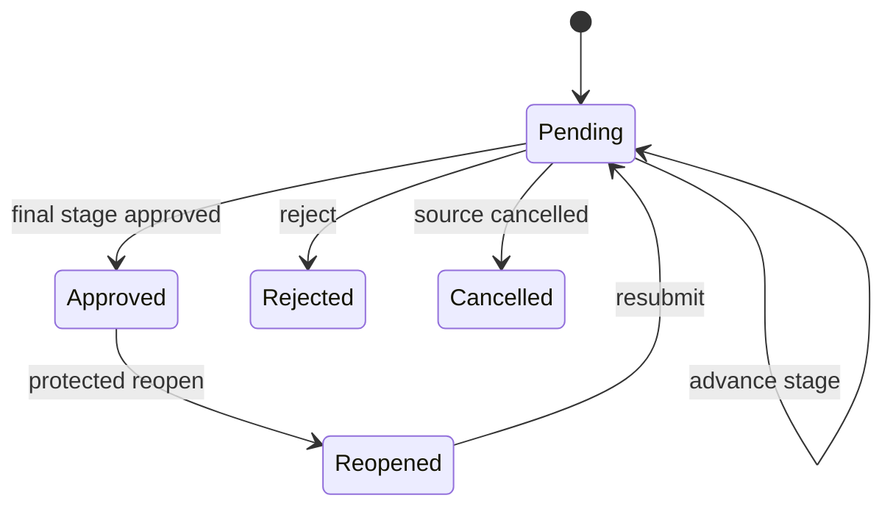

# Approval and Policy Engine Specification

**Governing requirements:** WOS-CORE-003, WOS-CORE-005; WOS-ORG-009; WOS-IAM-003, WOS-IAM-005, WOS-IAM-010; WOS-APR-001 through WOS-APR-008; WOS-INT-002.

## Outcome

A reusable engine routes work, leave, assignment, budget, commercial and invoice-ready decisions through scoped, auditable and configurable stages and emits one canonical notification-event family for approval work across all domains.

## Policy model

A policy defines entity type, organization/legal entity, optional engagement/project/worker criteria, value threshold, stage sequence, approver role/relationship, SLA, reminder/escalation and effective dates.

An approval instance records source entity/version, requester, current stage, status, due date and immutable decision history.

## States

Only the current pending stage can be decided. Bulk operations independently validate every item and fail safely with per-item outcomes.

## Delegation

Delegations are time-bound, role/entity scoped and cannot exceed the delegator's current permission or data scope. Revocation and leaver changes invalidate future use.

## Period policy

Periods progress through Open, Submission Closed, Approval Closed and Financially Locked. Protected reopen requires reason, authority and audit; it does not erase prior decisions or snapshots.

## Canonical approval notification events

The approval engine, not individual domain modules, emits the shared versioned `approval.*` events defined by WOS-INT-002 for work, leave, assignment, commercial and invoice-batch approvals:

| Event/template key | Trigger | Default relationship recipients | Policy class |
|---|---|---|---|
| `approval.action_required` | A valid generic approval stage becomes pending | Current-stage approver or approvers | `ACTION_REQUIRED` |
| `approval.rejected_or_correction_required` | Rejection or correction-required decision | Requester plus affected worker where distinct | `ACTION_REQUIRED` |
| `approval.completed` | Final approval | Requester plus affected worker where distinct | `INFORMATIONAL` |
| `approval.overdue_or_escalated` | Due threshold exceeded or escalation created | Current approver or approvers plus configured escalation target | `CONTROL_MANDATORY` |

Event identity is deterministic from approval-instance ID/version, stage or decision version, event key and triggering operation ID. Replaying the same transition or retrying delivery must not create a second domain event, in-app record or accepted channel-delivery result.

### Mutually exclusive domain-action events

Domain modules may emit their own canonical action event only outside a pending generic approval stage:

- `commercial.approval_required` is a **pre-submission requester/change-owner event**. It may be emitted only when a proposed rate, budget, PO, contract-term or commercial-policy mutation is policy-blocked because the requester/change owner must create, complete or submit the generic approval request. It is never emitted for approvers and never emitted when a valid generic approval stage is pending.
- `invoice_batch.action_required` is a **batch-owner remediation event**. It may be emitted only for pre-submission evidence, reconciliation, validation or export-preparation deficiencies while no generic approval stage is pending. A generic approval rejection or correction-required decision uses `approval.rejected_or_correction_required`, not `invoice_batch.action_required`.

For one source entity/version and triggering operation, at most one action-required notification event may be created. If a generic approval stage becomes pending, `approval.action_required` is the exclusive action-request event and suppresses the two domain-action events for that transition.

Domain modules may provide approved template variables and source links, but must not create competing event keys such as separate timesheet-, leave-, assignment-, commercial- or batch-specific versions of the same approval transition. Domain-specific non-approval events remain separate, for example `assignment.created_or_materially_changed`, `commercial.risk_threshold_breached` and `invoice_batch.export_failed`.

Recipient resolution is server-authoritative. The engine resolves current approvers, requester, affected worker and escalation target from the approval instance, policy, delegation and organization/legal-entity/entity relationship at the triggering version. Client-supplied recipients, role labels or addresses are never authoritative.

## Authorization and audit

Decision authority combines active role, permission, organization/legal entity, source-entity relationship, policy stage and delegation. Decision, reassignment, escalation, delegation and reopen actions are audited.

Each emitted approval notification retains the approval-instance/source version, stage or decision version, triggering operation ID, recipient relationship/reason, policy class, template version, organization/legal-entity scope and notification idempotency identity.

## Acceptance cases

Positive:

- Single- and multi-stage approvals for work, leave, assignment, commercial and invoice-batch changes.
- Valid delegation decides only covered scoped items during its effective window.
- One `approval.action_required` event is emitted when a stage becomes pending and is delivered to the current-stage approvers.
- A policy-blocked commercial draft emits `commercial.approval_required` to the requester/change owner before submission, then emits only `approval.action_required` after the generic stage becomes pending.
- A batch evidence/reconciliation deficiency emits `invoice_batch.action_required` to the batch owner before submission, then emits only `approval.action_required` after the generic stage becomes pending.
- Rejection, completion and escalation emit the canonical shared event key once with the required relationship recipients and policy class.
- SLA reminders/escalations are idempotent and reportable.

Negative:

- Stale/non-current stage, out-of-scope record, expired delegation, self-approval prohibition and financially locked change are denied.
- Bulk selection cannot use one authorized record to authorize others.
- Changing a policy does not rewrite prior approval history.
- Retrying the same transition cannot emit duplicate approval events or accepted deliveries.
- A pending commercial or invoice-batch approval cannot also emit its domain-specific action-required event for the same operation.
- An approval rejection/correction cannot also emit `invoice_batch.action_required` for the same decision.
- A domain module cannot replace a canonical `approval.*` key with an incompatible domain-specific key.
- A caller cannot redirect a notification, suppress a mandatory recipient or broaden recipient scope.

## Migration and rollback

Existing approval records map to generic instances with preserved entity links and decisions. Compatibility endpoints remain until parity tests pass. Rollback preserves migrated records and disables new policy routes rather than deleting evidence. Notification-event migration preserves event/idempotency identities so replay cannot create duplicate records.
